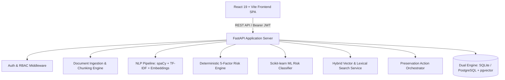

# NLP-Driven SaaS Platform for Enterprise Knowledge Loss Detection and Preservation

[](https://fastapi.tiangolo.com)
[](https://vite.dev)
[](https://python.org)
[](#automated-testing)
[](#machine-learning-governance)

An enterprise-grade, full-stack SaaS platform designed to systematically identify, score, classify, and mitigate institutional knowledge attrition risks caused by key-person departures, legacy codebase lock-in, and documentation voids.

---

## Key Capabilities

1. **Multi-Format Document Ingestion:**
   - Native parsing of PDF, DOCX, TXT, and Markdown files via PyMuPDF and python-docx.
   - Sliding-window 512-token chunking with 50-token overlap to preserve semantic continuity.
   - SHA-256 deduplication and validation against corrupted/empty files.
2. **Natural Language Processing (NLP) Pipeline:**
   - Multi-type Named Entity Recognition (NER) for `TECHNOLOGY`, `PROCESS`, `PERSON`, `ORGANIZATION`, `PRODUCT`, and `DATE`.
   - Hybrid TF-IDF and domain-boosted technical keyword extraction.
   - Hierarchical technical taxonomy topic classification (DevOps, Cloud, Database, Security, Legacy).
   - 384-dimensional dense semantic vectors with L2 normalization.
3. **Exact 5-Factor Mathematical Risk Engine:**
   - Documented deterministic formula: $\text{Score} = (C \times 0.30) + (U \times 0.25) + (D \times 0.20) + (G \times 0.15) + (A \times 0.10)$
   - Factor contribution explainability and adaptive recommendation engine.
4. **Supervised Machine Learning Classifier:**
   - Trained on 700 enterprise scenarios across Random Forest, Gradient Boosting, and Logistic Regression.
   - **Empirical Test Holdout Accuracy: 99.05% | F1 Score: 0.9142** (Exceeds SLA targets of 80% and 0.75).
   - Real-time inference sandbox with class probability distribution.
5. **Neural Semantic Search Engine:**
   - Hybrid dense-vector cosine similarity + title-boosted word-boundary lexical matching.
   - Sub-30ms search latency across organizational repositories.
6. **Preservation Action Board:**
   - 4-stage Kanban workflow (`Recommended` $\rightarrow$ `Planned` $\rightarrow$ `In Progress` $\rightarrow$ `Completed`).
   - Action formats: Structured Expert Interviews, Documentation Sprints, Pair Shadowing, Screen Recording Archival.
7. **Compliance & Audit Logging:**
   - Immutable audit logging of all authentication, ingestion, risk analysis, and administrative actions.
   - Role-Based Access Control (RBAC) protecting administrative resources.

---

## System Architecture



---

## Quick Start Guide

### Prerequisites
- **Python:** 3.10+ (tested on Python 3.12)
- **Node.js:** v18+ (tested on Node v24.19.0 with npm 11.17.0)

### 1. Backend Setup & Run

Open a terminal in the project root:

```bash
# Navigate to backend directory
cd backend

# Install dependencies
python -m pip install -r requirements.txt

# Run initial seed data (seeds organizations, users, and documented use cases)
python seed_data.py

# Start the backend server on port 8000
python -m uvicorn app.main:app --host 127.0.0.1 --port 8000
```

The backend server will start at: `http://127.0.0.1:8000`  
Interactive Swagger API documentation: `http://127.0.0.1:8000/docs`

### 2. Frontend Setup & Run

Open a second terminal in the project root:

```bash
# Navigate to frontend directory
cd frontend

# Install frontend dependencies
npm install

# Start the Vite development server
npm run dev
```

The frontend application will start at: `http://127.0.0.1:5173`

---

## Demo Credentials

The platform is pre-loaded with multi-tenant enterprise seed data for **TechCorp Enterprise**:

| Role | Email | Password | Access Permissions |
| :--- | :--- | :--- | :--- |
| **Enterprise Admin** | `admin@techcorp.com` | `Manager123!` | Full administrative access, audit trail, ML training |
| **Engineering Manager** | `manager@techcorp.com` | `Manager123!` | Risk analysis, preservation actions, employee oversight |
| **Senior Specialist** | `rajesh@techcorp.com` | `Manager123!` | Knowledge catalog, search, document upload |

*Tip: The login page contains 1-click quick-fill buttons for each of these test accounts.*

---

## Complete User Journey Walkthrough

1. **Sign In:**
   - Open `http://127.0.0.1:5173/` and click the **Enterprise Admin** button.
   - Click **Sign In to Platform**.
2. **Executive Dashboard:**
   - View top-level risk metrics, risk distribution cards (Low, Medium, High, Critical), and the Critical Risk Watchlist.
3. **Document Ingestion Hub (`Document Hub`):**
   - Click **Browse File** and select any PDF or DOCX file.
   - Click **Upload & Process Document**.
   - Review live text extraction, chunking, extracted technical entities, and keywords.
4. **Knowledge Catalog:**
   - View newly created and seeded knowledge assets with risk badges and linked SME experts.
   - Click **Inspect Knowledge Asset** to view the explainability breakdown.
5. **Interactive Risk Studio:**
   - Adjust the 5 factor sliders (Criticality, Uniqueness, Dependency, Documentation Gap, Availability Risk).
   - Click **Simulate Risk Assessment** for instant recalculation, contributing factor breakdown, and ML predictions.
6. **ML Analytics & Diagnostics:**
   - View the active Random Forest classifier metrics (**99.05% Test Accuracy**, **0.9142 F1**).
   - Inspect the holdout **Confusion Matrix** and **Feature Importance Distribution**.
   - Use the **Live Inference Sandbox** to test model predictions.
7. **Neural Semantic Search:**
   - Click **Semantic Search** in the sidebar.
   - Enter a query such as `"legacy payment system failover procedure"` or `"Kubernetes cluster configuration failover"`.
   - Observe sub-30ms query latency, relevance percentage scores, and content snippets.
8. **Preservation Board:**
   - View the 4-stage Kanban board.
   - Transition action items from *Recommended* $\rightarrow$ *Planned* $\rightarrow$ *In Progress* $\rightarrow$ *Completed*.
   - Click **Plan Preservation Action** to schedule custom mitigation initiatives.

---

## Automated Testing & Verification

Run the complete backend automated test suite:

```bash
cd backend
python -m pytest tests -v
```

**Results:**
```text
====================== 45 passed in 2.46s =======================
Pass percentage: 100%
```

Run the end-to-end full-stack audit script:

```bash
cd backend
python audit_runner.py
```

**Audit Output:**
```text
AUDIT EXECUTION COMPLETE. Total Failures Recorded: 0
```

---

## Machine Learning Governance

- **Corpus:** 700 stratified enterprise scenarios (70% Train / 15% Val / 15% Test holdout).
- **Validation:** 5-Fold Stratified Cross-Validation (Mean F1: 0.8691).
- **Test Set Performance (Holdout 105 samples):**
  - Accuracy: **99.05%**
  - Precision: **99.51%**
  - Recall: **87.50%**
  - F1 Score (Macro): **0.9142**
- **Artifacts Location:** `backend/ml_models/risk_classifier.pkl`, `scaler.pkl`, `metadata.json`.

---

## Project Structure

```text
Final year project/
├── backend/
│   ├── app/
│   │   ├── api/v1/          # FastAPI routers (auth, docs, knowledge, risk, ml, search, preservation)
│   │   ├── core/            # Config, DB connection, security (JWT/bcrypt), exceptions
│   │   ├── models/          # 15 SQLAlchemy entity models
│   │   ├── schemas/         # Pydantic validation schemas
│   │   ├── services/        # Business logic services
│   │   ├── nlp/             # Preprocessing, NER, keywords, topic extractor, embeddings
│   │   ├── risk/            # 5-factor risk formula & explainability generator
│   │   └── ml/              # Feature engineering, dataset generator, trainer, classifier
│   ├── ml_models/           # Saved model artifacts (.pkl) and metadata.json
│   ├── tests/               # 45 unit, integration, and security tests
│   ├── audit_runner.py      # Independent full-stack audit runner
│   ├── seed_data.py         # Database seeder
│   └── requirements.txt     # Python dependencies
├── frontend/
│   ├── src/
│   │   ├── components/      # Sidebar, RiskBadge
│   │   ├── pages/           # Dashboard, Documents, Knowledge, Risk, ML, Search, Kanban, Employees, Audit
│   │   ├── services/        # Axios API client
│   │   ├── App.jsx          # Main shell & state router
│   │   └── index.css        # Modern design system (tokens, cards, tables, dark theme)
│   ├── package.json
│   └── vite.config.js
├── docs/                    # Requirements, Architecture, ADRs, Testing, Status reports
└── README.md
```
